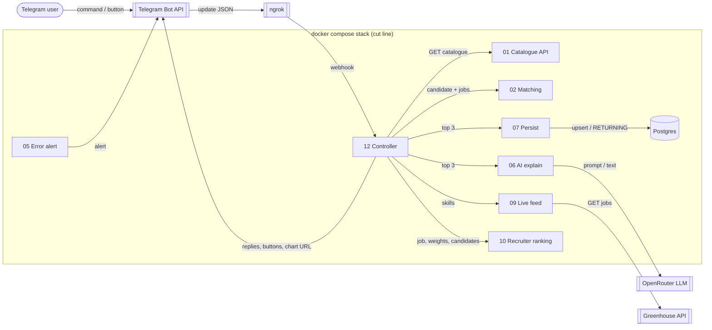

# BAIT n8n: internship matching assistant on Telegram

**The need, in one sentence:** students looking for an internship (and the recruiters reviewing
them) today scroll job boards and read CVs by hand, with no clear, explained answer to "which
internships do I actually fit, and why?"; this project answers that inside a Telegram chat.

BAIT is a startup I co-founded that matches students with internships. This school project
rebuilds BAIT's core loop as an isolated n8n automation, so I understand the technical background:
APIs, deterministic scoring, AI explanations, persistence, error handling and deployment.
All people and companies are **fictional**; real listings appear only in the labelled "Real market" view.

| Candidate side | Recruiter side |
| --- | --- |
| Pick a fictional student, browse 12 internships, get ranked matches with a per-skill explanation, AI advice, live public listings, and apply. | Pick a posting, rank its applicants (including students who applied in the chat, marked ★) with adjustable weights and threshold, see a chart, and notify applicants. |

## Architecture



The full diagram, with the data on every arrow, the diagram level and the cut line, is in
[docs/architecture.md](docs/architecture.md). Every node is explained in [docs/workflows.md](docs/workflows.md).

## Repository layout

| Path | Content |
| --- | --- |
| `docker-compose.yml` | n8n 2.43.7 + Postgres 16.4, named volumes, Postgres healthcheck |
| `.env.example` | Every environment variable, with placeholders (the real `.env` is git-ignored) |
| `init-db/01_schema.sql` | Project table `bait_recommendations`, created on first start |
| `workflows/` | Exported n8n workflows (JSON, no secrets) |
| `scripts/export-workflows.ps1` | Re-exports the workflows from the running n8n, with a secret check |
| `docs/` | Architecture, node reference, evaluation evidence, screenshots |

## Setup: from clone to running

Prerequisites: Docker Desktop, a Telegram bot token (from @BotFather), an OpenRouter API key,
and an HTTPS tunnel such as ngrok.

```powershell
git clone <this repo> bait-n8n
cd bait-n8n
copy .env.example .env          # then edit .env: encryption key, tunnel URL, DB password
ngrok http 5678 --url=<your ngrok domain>   # in a second terminal
docker compose up -d
docker compose ps               # postgres must show (healthy), n8n Up
```

Open http://localhost:5678, create the owner account, then import the workflows:

```powershell
docker compose exec n8n n8n import:workflow --separate --input=/import/workflows
```

In n8n, create three credentials (Credentials → Add): **Telegram account** (bot token),
**OpenRouter BAIT Valid Key** (API key) and **BAIT Project Postgres** (host `postgres`, port 5432,
database/user/password from `.env`). Open each workflow, select the credential where a node
asks for it, set *Settings → Error workflow* to "BAIT LAB 05 - Error Capture", then **Publish**
workflows 01, 02, 05, 06, 07, 09, 10, 11 and 12. In workflow 12, *Normalize Update* and in
workflow 05, *Send Alert to Owner*, replace the owner chat id with yours.

### Environment variables

| Variable | Purpose |
| --- | --- |
| `N8N_ENCRYPTION_KEY` | Encrypts stored credentials. Must stay the same, or credentials become unreadable. |
| `N8N_WEBHOOK_URL` | Public HTTPS URL (ngrok) that Telegram calls. |
| `POSTGRES_DB`, `POSTGRES_USER`, `POSTGRES_PASSWORD` | Project database. Not exposed outside Docker. |

Data survives `docker compose down` then `docker compose up -d` (named volumes `n8n_data` and
`postgres_data`). Only `docker compose down -v` deletes it.

## How to test

| Test | How | Expected |
| --- | --- | --- |
| Full round trip | Telegram: `/start` → I'm a candidate → Alex → My matches | 5 score cards, "Top 3 saved to Postgres" |
| Idempotency and state across runs | Tap My matches twice | Still 3 rows; "saved 2 times since …" read back from Postgres |
| Second route | I'm a recruiter → Data Analyst · Northstar | Stats, chart, ranked list |
| Invalid input | `/foo` or `/recruiter skills=90` | Usage message; settings unchanged |
| AI with validation | 🤖 AI advice | 3 lines, titles and scores checked; fallback text if the AI fails |
| Live failure + error workflow | `/drill` | Safe reply in the chat **and** a "BAIT ALERT" with the execution link |
| On demand, no phone | Workflow 12 → Manual Test Run (sample update), or workflow 12 TEST / 11 | Green execution |
| Database | `docker compose exec postgres psql -U bait_app -d bait_demo -c "select * from bait_recommendations"` | One row per candidate + job |

## Screenshots

See [docs/screenshots](docs/screenshots).

## Safety and scope

- Fictional data only; isolated from BAIT's production Postgres/Prisma backend.
- The bot answers only the owner's chat id; duplicate Telegram deliveries are ignored.
- Scores are computed by code; the AI only explains them and its output is validated.
- No secrets in Git: credentials live encrypted in n8n, real values only in `.env`.
