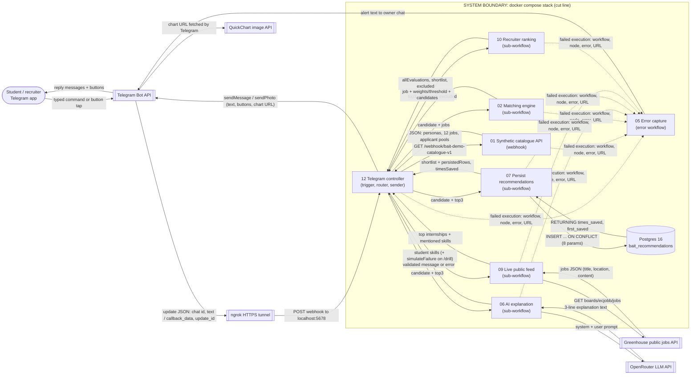

# Architecture

**Level of this diagram:** level 2, *containers and workflows*. Each box is either an external
service, a Docker container, or one n8n workflow. The nodes inside each workflow are documented
in [workflows.md](workflows.md) (level 3).

**Cut line (system boundary):** everything inside the dashed box runs in this repository's
Docker Compose stack on the laptop (n8n + Postgres). Everything outside it is a third-party
service reached over HTTPS: Telegram, ngrok, Greenhouse, OpenRouter and QuickChart. The
synthetic catalogue (workflow 01) is *inside* the boundary on purpose: no real BAIT data
crosses the cut line.

## Why it is split into sub-workflows

| Workflow | Role | Why separate |
| --- | --- | --- |
| 12 | Controller: receives every Telegram update, decides the action, sends replies | Only workflow that talks to Telegram; keeps UI logic in one place |
| 01 | Read-only catalogue API | Same contract as a real BAIT API would expose; swap the URL to go live |
| 02 | Candidate-to-jobs matching | Pure scoring logic, reused twice (matches and AI advice), testable alone |
| 06 | AI explanation | Isolates the only non-deterministic step; its failure cannot break scoring |
| 07 | Persistence | Database concerns in one place; can switch Data Table to Postgres without touching 12 |
| 09 | Live market evidence | External, unreliable API; isolated so a failure is contained (used by /drill) |
| 10 | Recruiter ranking | Declared inputs (job, candidates, allSynthetic); reused by 12 and tested by 11 |
| 05 | Error workflow | Linked in every workflow's settings; alerts the owner with the execution link |
